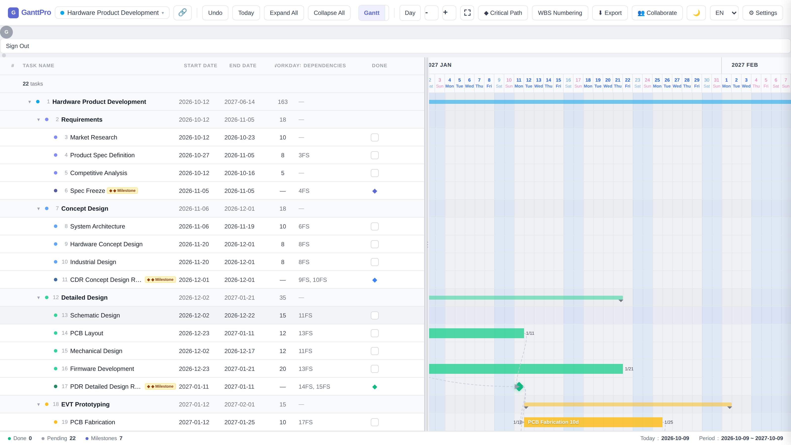
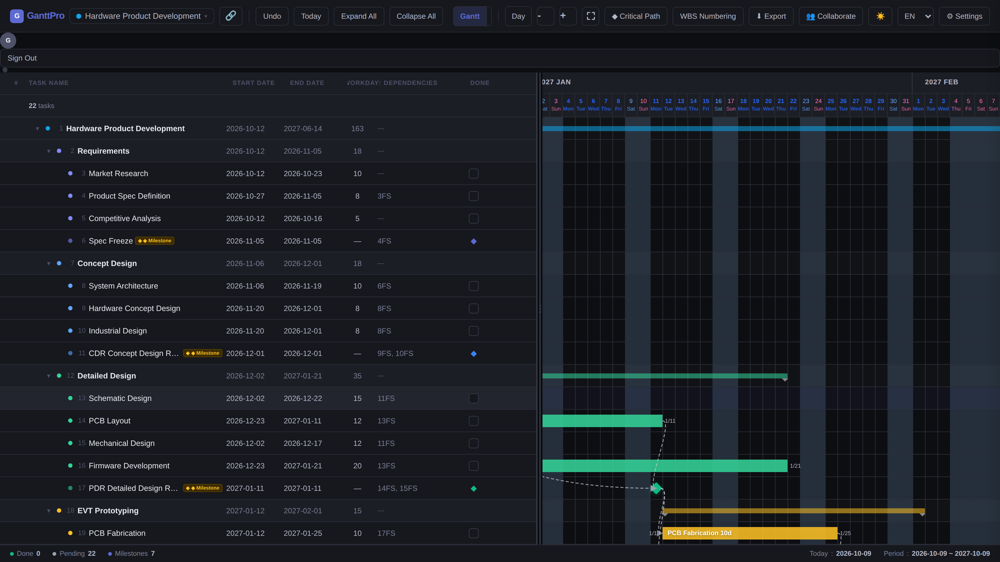
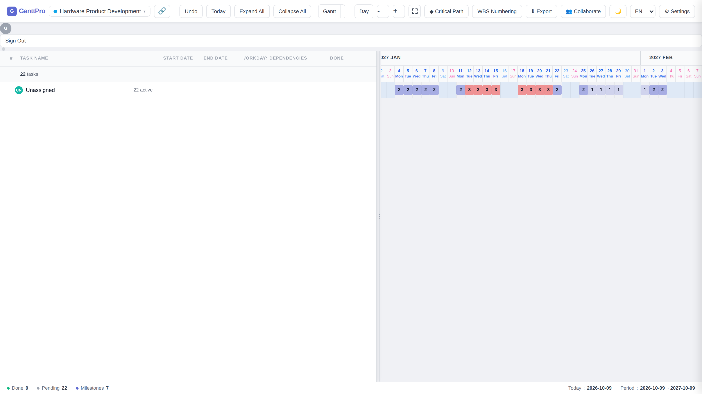

# GanttPro

Browser-based project planning with interactive Gantt charts.

[繁體中文](README.zh-TW.md)



## About

GanttPro helps project teams organize work, schedule tasks, and follow progress in a Gantt chart. It is a single-page
application built with vanilla JavaScript modules, Vite, and Firebase. The interface supports English and Traditional
Chinese.

## Quickstart

Requirements: Node.js `^20.19.0` or `>=22.12.0` (the version ranges declared by the locked Vite dependency) and npm.

```bash
npm ci
cp .env.example .env
```

Edit `.env` with your Firebase web app settings. Enable Google sign-in and Cloud Firestore in that Firebase project. Set
`VITE_ADMIN_EMAIL` if you need the admin panel or will generate Firestore rules. Then start the development server:

```bash
npm run dev
```

Vite serves the app at <http://localhost:5173>. See [Development](docs/development.md) for build, test, formatting, and
Firestore-rules commands.

## Features

### Plan and schedule work

- Organize tasks into groups and milestones; rearrange the task hierarchy.
- Link tasks with FS, SS, FF, or SF dependencies and lag. The scheduler calculates dates from those links, and
  critical-path analysis highlights tasks with no scheduling float.
- Use a Taiwan working-day calendar, set workdays and custom holidays, and track assignees, progress, completion,
  approval status, and evidence links.

### View and track a project

- Switch among Gantt, milestone, and workload views; zoom by day, week, or month.
- Compare current dates with a baseline, save and restore project versions, and review the project audit log.
- Use light or dark mode and task-table controls such as WBS numbering.

### Share and export

- Sign in with Google for cloud features, or use guest mode for local work.
- Invite collaborators with read or edit access, or create a read-only share link. The two share-link modes have
  different privacy and revocation behavior; see [Firebase and security](docs/firebase-security.md).
- Export a chart as PNG, print or save it as PDF, and export task data as CSV or iCalendar.

## Screenshots

### Dark mode



### Workload view



## Documentation

- [Documentation index](docs/index.md)
- [Development setup and commands](docs/development.md)
- [Architecture and source layout](docs/architecture.md)
- [Firebase configuration and security boundaries](docs/firebase-security.md)

## Project status

This is a private project (`package.json` sets `private: true`). The repository does not currently include a license
file.
